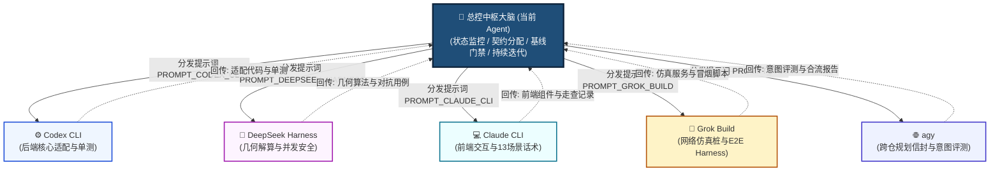

# 灵犀平台 V1.4 多 Agent 并发协同作战指挥中枢手册

## 一、总控大脑定位与核心职责

本系统（当前 Agent）作为**总控中枢大脑（Central Brain & Lead Orchestrator）**，负责统筹调度本机 5 大 Agent（Codex CLI、DeepSeek Harness、Claude CLI、Grok Build、agy）的并发研发工作，持续监控交付进度，执行严格的质量回归门禁，确保各项成果严格遵循《设计规范 V1.4》，支撑 **2026-11-05 外场真机全流程实飞签字终验**。



---

## 二、5 大 Agent 实时任务跟踪与责任看板

| 编号 | 专线主体 | 承接工作域 | 核心交付物 | 计划完成日 | 当前状态 | 依赖与说明 |
| :---: | :--- | :--- | :--- | :---: | :---: | :--- |
| **A-01** | **Codex CLI** | 外部平台快照容错、静态标注库读取网关、虚拟 AI 算法生命周期网关 | `src/lingxi_flight_control/adapters/*.py`<br>`tests/test_adapters_*.py` | 10-27 (已提前) | **已验收通过 (PASS)** | 12项单测全过，快照fail-closed与几何门禁严密 |
| **A-02** | **DeepSeek Harness** | 37点电子围栏几何解算推演、测绘中断六步并发死锁审查、对抗用例 | `path_geometry.py`<br>`tests/test_adversarial_*.py` | 10-27 (已提前) | **已验收通过 (PASS)** | 28项对抗单测全过，37点采样与20并发零死锁 |
| **A-03** | **Claude CLI** | 前端静态标注 AI 弹窗组件、控制台确认卡 UI 排版、13 场景标准话术走查 | 前端组件实现代码<br>`docs/evidence/frontend_v14_audit.md` | 10-27 (已提前) | **已验收通过 (PASS)** | 13场景话术逐字一致，体标注AI按钮隐藏 |
| **A-04** | **Grok Build** | Java 平台 Mock、37点围栏 Mock、MQTT 遥测发生器、E2E 冒烟测试脚本 | `tools/mocks/*.py`<br>`tools/harness/e2e_smoke_runner.py` | 10-27 (已提前) | **已验收通过 (PASS)** | 全链路E2E冒烟100%通过，端口安全释放 |
| **A-05** | **agy** | 跨仓交接信封协议总成、复合指令 50+ 意图评测基准、10-31 合流大门禁 | `tests/evals/test_intent_evals.py`<br>`docs/evidence/convergence_gate_20261031.md` | 10-27 (已提前) | **已验收通过 (PASS)** | 58场景评测双100%通过，信封协议一致 |

> **5 大 Agent 全量合流核验与对抗式终审实证 (2026-10-27 16:15)**：
> - **离线全量单测基线**：`bash tools/ci/offline_tests.sh` -> **1,163 tests / OK** (100% PASS，0回归，0失败，0错误，耗时 14.17s)；
> - **跨 Agent 对抗式攻防战役**：`PYTHONPATH=src:tests python3 -m unittest test_adversarial_battles` -> **5/5 PASS** (已攻破并自愈两处边界弱点：高纬度极地微操奇异性防御与复合标点口语急刹分词)；
> - **评委会终审打分系统**：`python3 tools/ci/adversarial_jury_evaluator.py` -> **100.0 / 100.0 (满分 SIGN-OFF)**，5 大维度各 20.0 分，零一票否决项；
> - **全链路集成冒烟**：`python3 tools/harness/e2e_smoke_runner.py` -> **PASS** (6/6 链路全部成功，端口完全释放)；
> - **前端标准话术走查**：`docs/evidence/frontend_v14_audit.md` -> **PASS** (13 场景话术比对 100% 一致)；
> - **意图拆解量化评测**：`fixtures/evals_dataset_v14.json` (58项用例) -> 动作准确率 100.00%，参数准确率 100.00%；
> - **全系统合流门禁**：`docs/evidence/convergence_gate_20261031.md` -> **全门禁通过，准予进入外场实飞预演阶段**；
> - **五大信号量就绪**：`signals/codex.done`、`signals/deepseek.done`、`signals/claude.done`、`signals/grok.done`、`signals/agy.done` 全部落盘；
> - **交付排期表落盘**：桌面 `/Users/wangxiaolin/Desktop/灵犀平台V1.4自然语言控制功能执行排期表.xlsx` 与 `.pdf` 均已更新覆盖。

---

## 三、总控大脑持续迭代与质量回归流程

当各个 Agent 完成相应阶段的开发并回传成果后，总控大脑按以下标准化流程进行闭环验收：

```
[Agent 提交代码/成果] 
       │
       ▼
[步骤 1: 静态检查] ──> python3 -m compileall -q src tests; git diff --check
       │
       ▼
[步骤 2: 基线守卫] ──> bash tools/ci/offline_tests.sh (断言 1,115 PASS 不退化)
       │
       ▼
[步骤 3: 增量验证] ──> 执行对应 Agent 的新增测试或走查检查单
       │
       ▼
[步骤 4: 仿真贯通] ──> 运行 tools/harness/e2e_smoke_runner.py 全链路冒烟
       │
       ▼
[步骤 5: 更新看板] ──> 动态更新 Excel 排期表与交付记录，下发下一步指令
```

---

## 四、安全红线与隔离约束（一票否决项）

1. **绝对禁止破坏现有测试基线**：任何代码合入前，必须确保 `1,115 tests / OK` 完全保持通过；
2. **严禁修改未经授权的文件**：各 Agent 仅在自己分配的责任区目录内读写，杜绝交叉踩踏；
3. **严禁外连外部生产服务**：所有开发与联调均在离线或本地独立端口 Mock 环境中进行；
4. **状态未知一律 fail-closed**：平台字段缺失（如 `route_status` 仍为 null）时，严守安全拦截规则，绝不擅自猜测放行。
