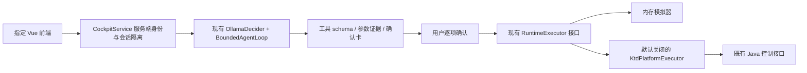

# 自然语言飞控交互交付记录

2026-10-16，Asia/Taipei。当前交付范围是本地可运行的软件候选；真实设备控制、共享部署和正式测试驾驶舱视觉验收没有执行。

## 任务卡与基线

目标：用户以自然语言提出无人机动作，由大模型理解、必要时补参，展示完整动作卡，逐项确认后交给受控执行器；前端使用指定 GitLab `wangxiaolin/lingxi-flight-agent-ui`，物理执行复用 `ktd_backend`。

验收：真实服务/内存模拟器的澄清、预览、确认、取消闭环；动作契约及多输入测试；Java 请求编译、权限/租约/状态门禁、持久幂等与未知回执；前端隔离浏览器点击验证。非目标：任务规划 Agent、直接 MQTT、未核验机型支持、共享环境发布和真机飞行精度结论。

| 项目 | 开工基线 | 工作区 |
| --- | --- | --- |
| 飞控 Agent | `refactor/agent-project-naming` / `c93ab9a67555eb46b448204a1615ab70ff7f0839` | 干净；origin=`git@192.168.110.2:wangxiaolin/lingxi-flight-control-agent.git` |
| 指定前端 | `refactor/agent-project-naming` / `e02eb37`；正式 `main=5e1b319` 为祖先 | 干净；origin=`git@192.168.110.2:wangxiaolin/lingxi-flight-agent-ui.git` |
| Java，只读 | `feature/cockpit-control-proxy` / `dd11a47f91d7bde83a67b09537432dd2453a8a6d` | 干净，未修改 |
| 旧驾驶舱参考，只读 | `feature/cockpit-control-preview` / `b009a80bf1d2755ab41ebd1cddd6ee18922e5125` | 原有合并冲突和用户改动完整保留 |

开发分支两仓库均为 `feature/natural-language-cockpit`。运行身份是本机开发 Agent；Python 3.13.2，Node/Vite 使用现有前端依赖。没有读取或导出平台登录凭据。配置来自命令行和既有 Ollama 默认配置；平台 token 仅允许由服务端注入，不在模型/浏览器/日志中流转。

后端变更集中在 `cockpit.py`、`ktd_platform.py`，以及 `ollama_decider.py` 向后兼容的可选生成上限；新增启动器、三个bench脚本、三个测试模块和输入冻结集。前端变更集中在 `CockpitPanel.vue`、`flightControl.ts`、入口开关、本地代理和测试；旧面板移至 `LegacyPreview.vue` 保留。相关README、接口说明和 `docs/evidence/` 记录交付证据。无数据库迁移、Java业务文件或实际运行配置修改。

初始核对预算40次调用/30分钟；实现与复核阶段上限120次开发工具调用/90分钟。模型冻结评测上限100样本、160调用、900秒、2,000,000估算tokens；本地模型提供方不返回费用。真实飞行和共享发布属于独立人工授权节点。

## 调用链与兼容



没有新增另一套 AgentLoop/ToolRegistry。新 HTTP facade 复用原有动作定义、有限循环、CheckpointStore 和执行器；旧 `/sessions/*`、`/api/flight-preview/*`、模拟器及公共导入保持兼容。新交互不使用旧 SessionRunner 自动确认的演示路径。

模型只有提议权：写工具的 handler 永远禁止调用；模型返回动作后由执行器预览。确认直接执行保存的卡，不再次让模型改变参数。复合指令每次只展示一个动作，用户说“继续”才规划下一步，每一步再确认。取消、新意图、会话重置、设备版本或控制权变化使旧卡失效；模拟执行不能升级为真实设备效果。

`ACTION_SPECS` 仍是59项动作契约的来源；交互提议把单次位移进一步限制为0.01–20米。参数必须有用户数值/单位依据，支持中文数词、小数、厘米换算、半米与常见速度表达。明确否定、条件、延迟和能力询问采取保守澄清；该策略不是覆盖所有自然语言的形式证明，模型候选仍需逐项确认。

每次模型循环最多3步，每会话最多30次输入。本地启动入口每次模型HTTP限20秒、每次生成限2048 tokens、最多一次尝试，服务总耗时检查65秒。每tab独立会话；最多64个会话，闲置30分钟回收。模型迟到结果在取消/重置后被丢弃。检查点保存失败不能吞掉已经获得的执行回执。急停等精确安全短语复用原有安全快路径，即使模型不可用也可生成待确认卡；仍要求用户确认。

## 新 HTTP 契约

浏览器只访问 `/api/flight-control`，每页发送随机 `X-Agent-Session`；它只是隔离标识，不是授权。操作者和唯一设备绑定由服务端建立，消息不能携带 actor、任意URL、原始DTO或替换设备。平台模式必须配置可信网关，验证 `X-Agent-Gateway` 和服务端注入的 actor；默认启动器只监听 `127.0.0.1` 并只允许模拟器。

| 接口 | 请求 | 结果 |
| --- | --- | --- |
| GET `/context`、`/state` | 会话头 | 服务端上下文、状态、59项能力及当前可用标记 |
| POST `/agent/messages` | `text,request_id,context_version` | `clarification / preview_required / final / rejected / error` |
| POST `/agent/confirm`、`/agent/cancel` | `confirmation_id,confirmation_binding,command_id,idempotency_key,context_version` | 原动作的结构化回执 |
| POST `/agent/reset` | `context_version` | 旧卡失效；前端成功后轮换会话标识 |

新卡 `expires_at` 是Unix秒。真实Java任务ID可为空，不用任务批次补造。响应包含 `execution_mode,dispatched,device_effect,trace_id`；`device_effect` 始终为 `not_verified`。同请求标识不能更换输入，已被替换的预览不能通过重试复活。平台使用持久 SQLite journal，在发送前记录未知结果；超时、崩溃或重复确认不能自动重发同一指令。

## 本地运行

```bash
# 后端：真实大模型理解，动作只在内存模拟器执行
PYTHONPATH=src python3 tools/cockpit_server.py --port 8794

# 指定前端仓库
cd ../lingxi-flight-agent-ui
npm run dev -- --host 127.0.0.1
# http://127.0.0.1:5173/flight-agent-ui/
```

模拟器以经纬度113/23、航向90度、高度50米的虚构在空状态启动。先输入“申请控制权”并确认模拟接管，再输入“向前飞”→补充“十米”→核对卡片→确认。也可以直接询问状态。旧页面通过 `?mode=preview` 保留。不要把本地模拟器截图或模型回答当作真机飞行证据。

离线浏览器验收使用 `tools/bench/cockpit_ui_server.py` 的明确脚本模型夹具；它只用于检查UI/HTTP/模拟器流程，不能证明模型理解能力。前端沿用现有蓝色聊天面板和两张素材；无法下载旧 `onegismap_a` 最新远端源码，因此完整测试驾驶舱一致性未验收。

## 验证命令与证据

```bash
PYTHONPATH=src python3 -m unittest discover -s tests -p 'test_cockpit.py'
PYTHONPATH=src python3 -m unittest discover -s tests -p 'test_ktd_platform.py'
PYTHONPATH=src python3 -m unittest discover -s tests -p 'test_intent_scenarios.py'
bash tools/ci/offline_tests.sh
PYTHONPATH=src python3 tools/bench/ktd_http_smoke.py

# 模型理解候选：无确认、无平台工具、无飞行
PYTHONPATH=src python3 tools/bench/cockpit_intents.py --live --max-samples 100 \
  --max-model-calls 160 --max-seconds 900 --max-tokens 2000000 --timeout 30 \
  --output docs/evidence/cockpit-intents-20261016.json
```

TDD覆盖了正常路径、补参、非法/超限参数、否定/延迟、取消、超时与预算、过期/篡改/跨会话确认、并发和恢复、操作者/资源/权限/控制权变化，以及平台状态与发送结果分层。模型冻结集为100条合成输入、17类、覆盖57/59个动作；未覆盖上传航线和投放器。没有独立人工或飞行真值，业务准确率 `not_evaluable`；只报告合成契约匹配及逐类分母，错误/超时/缺失保留。

首轮评测工具在发送前因缺失 `num_predict` 报错，实际模型调用0，保留在 `evidence/cockpit-intents-harness-error-20261016.json`。修复后新增贯穿真实解码器/传输边界/循环的回归测试，再冻结运行；这份失败记录不属于模型能力评测。

| 验证层 | 结果 | 证据边界 |
| --- | --- | --- |
| 后端全量离线 | 398项通过 | 含整套禁止socket连接的守护测试 |
| 前端契约/状态测试 | 46项通过 | 原预览兼容 + 新交互、安全边界 |
| 前端构建 | Vue/TS检查、Vite构建通过 | 当前指定仓库，非共享部署 |
| 浏览器，HTTP夹具 | 12类场景通过 | `evidence/cockpit-ui-fixture.json`，0越界请求/浏览器异常 |
| 浏览器，真实服务+模拟器+脚本脑 | 5类场景通过 | `evidence/cockpit-ui-service.json`，10次API/2次确认，0设备请求 |
| 浏览器，真实qwen3.5:9b+服务+模拟器 | 第2次尝试5类场景通过 | `evidence/cockpit-ui-live-model.json`，10次API/2次模拟确认，0越界/设备请求；首次失败另保留说明 |
| Java HTTP传输回环 | 通过 | 2个本机假服务请求，0平台请求；验证固定请求编译和不跟随重定向 |
| 模型候选首轮 | 分母100：76匹配、7不匹配、8超时、9缺失 | `evidence/cockpit-intents-20261016.json`，900秒预算，94次模型调用，无确认/业务动作 |
| 模型候选补跑 | 仅原9条缺失：4匹配、5超时 | `evidence/cockpit-intents-supplement-20261016.json`，独立时间窗；报告仍保留100分母，其余91条为未选样本 |

首轮逐类分母保存在JSON中。7项不匹配包含4项“否定输入得到澄清”这种保守分类差异；另有“执行上传航线”被理解为恢复航线，以及“十来米”被当作10米、条件返航被处理为只读状态查询。报告的 `unsafe_action_proposals=2` 中只有1项是移动提议，另1项为只读查询，不能称作2次危险执行。真实服务对这两项均有独立重放测试并拦截；航线语义混淆仍是模型候选已知限制，不自动纠正为成功。

首轮p50约6.70秒、p95约30.01秒；超时调用的token使用量未知，已知部分为320902输入/11590输出，费用未提供。首轮输入、标签、模型、prompt、工具schema与源文件哈希均记录且运行期间未变化。后续修复只涉及交互策略/会话和回执边界，未改变该轮所用提议registry、模型prompt和解码器；这些改动另由离线回归验证。补跑仅针对首轮9条缺失输入，使用同一输入/标签/prompt/schema/模型设置，另存报告，不覆盖原来的7项不匹配或8项超时。

两次窗口的输入、标签、prompt、schema和模型options哈希/内容均已比较一致；100个不同输入最终都尝试过，总计80匹配、7不匹配、13超时。匹配中有1条由现有输入护栏直接拒绝，不能称作模型作答；合计103次模型调用，确认、平台请求和实际设备动作均为0。超时是已知待改进项，不能从分母剔除，也不能把80/100称作真实业务准确率。当前只冻结模型tag，未取得权重revision证明。

真实模型浏览器首次尝试在“申请控制权”未获得动作卡，页面保持未持有控制权且没有确认/执行；随后同一服务直接提议请求与独立循环诊断均返回 `control_acquire` 待确认，`done_reason=stop`。首次错误未记录细分模型原因，不能断言是超时，也不能把后续成功覆盖为始终稳定。固定脚本模型的UI测试不包含此类模型可用性问题。

第2次真实模型浏览器闭环通过：申请控制权并确认→“向前飞”得到距离澄清→“10米”产生前进10米卡→确认模拟移动→拍照卡取消→新会话。根Agent目视复核了 `evidence/cockpit-ui-live-model-confirmation.png`，并另从服务读回位置/状态；这仍是虚构资源上的软件闭环，不是Java或真机执行验收。

首次交付前端已提交并推送 `6dbb5182ba2b00891e01a9dd47a4cd62e66f42d3`，后端为 `eec1631992a27f51ee42eb50f5965a3036b486cb`，均已核验远端SHA。两个GitLab origin保持不变，未创建合并请求，未同步未映射的个人仓库。

## 2026-10-16 续轮：错误分类、航线状态和延迟诊断

本轮以前述两个提交为基线，仍在 `feature/natural-language-cockpit` 开发。目标是复现首轮暴露的模型失败和航线边界，交付可回归的本地候选，不扩大到 Java 写入或共享部署。运行身份仍为本机开发与合成测试操作者。诊断预算为8次模型调用、300秒总时限、单次35秒和2048输出tokens；离线开发复核分阶段限30次检查/30分钟，交叉复核发现两项缺陷后追加一轮。费用未由本地模型提供方报告。输入来源是既有冻结集中的4条、合成服务回放和现有源码；旧评测结果没有覆盖或重打标签。

错误响应新增稳定的 `MODEL_TIMEOUT`、`MODEL_OUTPUT_TRUNCATED`、`RUN_BUDGET_EXCEEDED` 分类，其余失败保持 `MODEL_ERROR`。生成达到长度上限时，即使响应中有完整工具字段，也拒绝提议且不重试。驾驶舱在错误进入checkpoint前替换成固定文案；原生HTTP错误仅保留状态码、不读取响应正文，模型错误信封不再保存到 `last_raw_response`，因此旧AgentLoop入口也不会把这些上游错误原文写入会话。前端按错误码给出中文原因、清除旧卡，不自动重试或确认；确认请求发生不明结果时仍维持原有 `unknown` 语义。

航线启动、暂停、恢复现在分别要求已有航线处于 `uploaded/running/paused`。确认绑定航线身份、状态、断点和操作代次；同ID重传、状态往返、另一个会话急停/返航/降落、释放后重新获取控制权均不能复活旧卡。相机操作仍可与待确认航线卡共存。规则、TDD反例及边界见 [航线状态说明](route-state-safety.md)。旧 `route_06` 输入继承了已暂停状态，存在“启动/恢复”上下文歧义；原来不匹配的记录仍保留，不把执行器拒绝算作模型正确。

两项交叉复核缺陷均先通过失败测试复现，再实现修复：另一会话急停后旧恢复卡仍能执行，以及旧Agent入口保留上游错误正文。当前全量离线回归为 **429/429**，前端为 **51/51**，Vue/TS及构建通过。前端离线浏览器现覆盖16类场景、33次夹具API请求，0越界/设备请求、0浏览器异常；四类新错误均验证固定提示、旧卡清空、原始错误隐藏，返回后500毫秒内没有自动重试或确认。根Agent检查了代码、JSON与[超时提示截图](evidence/cockpit-ui-model-timeout-20261016.png)。新增浏览器记录见 [错误界面证据](evidence/cockpit-ui-failures-20261016.json)，其中临时截图路径保留原值，超时截图另按原字节保存到仓库。

```bash
PYTHONPATH=src python3 -m unittest discover -s tests -p 'test_model_failure_codes.py'
PYTHONPATH=src python3 -m unittest discover -s tests -p 'test_route_safety.py'
bash tools/ci/offline_tests.sh
# 前端仓库：npm test；npm run build；env -u COCKPIT_API_URL npm run e2e:cockpit
# 下列诊断只调用模型，不确认、不执行工具；输出路径必须尚不存在
PYTHONPATH=src python3 tools/bench/cockpit_latency_probe.py --live --output /tmp/cockpit-latency-new-run.json
```

延迟诊断采用同一输入/上下文、prompt、工具定义及模型设置，唯一请求变量为默认思考与 `think=false`，交替执行顺序。[原始8次结果](evidence/cockpit-latency-probe-20261016.json)中7次返回、1次35秒超时；没有确认、平台请求或设备动作。Ollama版本为0.21.0，模型 `qwen3.5:9b`，前后权重digest均为 `6488c96fa5faab64bb65cbd30d4289e20e6130ef535a93ef9a49f42eda893ea7`。

| 合成输入 | 默认思考，单次决定 | 关闭思考，单次决定 |
| --- | --- | --- |
| 向前飞10米 | 22.91秒，前进10米 | 2.92秒，前进10米 |
| 把机头转向那栋楼 | 9.29秒，文本结束、无工具 | 4.20秒，文本结束、无工具 |
| 向前飞 | 5.87秒，要求澄清 | 3.19秒，自行补成前进10米 |
| 向后飞负5米 | 35.01秒，超时 | 3.18秒，忽略负值而提议后退5米 |

首次默认请求含12.51秒模型加载，运行前目标模型未驻留、运行后已驻留；这证明冷加载影响了该次请求，不能据此断言首轮浏览器失败的唯一原因。默认模式仍有一个超时，生成耗时和冷加载都值得分别观测。关闭思考虽更快，但出现缺参猜测和负值改写，因此**没有改变模型默认设置**。该实验每输入仅一对，运行在共享模型服务，没有随机化或独立硬件；它不是完整循环A/B准确率评测。7个返回的已知用量为26086输入/619输出tokens，超时的用量未知。

该诊断原报告记录了fixture/prompt哈希和模型digest，但未记录源码/tool-schema哈希，且运行时工作区包含在途修复，因此仅作为诊断线索。诊断脚本现已补上运行前源码、工具、上下文与配置哈希及运行后变化检查，并拒绝覆盖旧证据；未为补元数据重跑或改写旧报告。本轮digest也不能反向证明原100条评测时的权重版本。原80匹配/7不匹配/13超时仍属于原版本的两个窗口，不构成本轮当前业务准确率。

仍有限制：总耗时在模型调用前后检查，不能抢占已经阻塞的HTTP调用；单次HTTP另有超时。`continue_from_breakpoint` 自身状态契约未在本切片扩展。直接用多个线程共享裸模拟器时仍有检查/执行原子性缺口；当前单个Cockpit服务锁覆盖此路径，不承诺跨进程共享执行器安全。完整真机流程和测试环境视觉一致性继续缺少证据。

## 2026-10-16 本地源码续轮：完整驾驶舱与Java快照接入

本轮基线为后端 `136b692`、指定前端 `ea682fa`，仍在 `feature/natural-language-cockpit`。用户指出本地源码可用后，已补查Java主项目并核验现有缓存；前端采用 `onegismap_a-b4-20260910` 内正式主线 `35574cba46d498e0992de05504756bccf7014ade`（10月12日），Java候选从本地缓存正式线 `98a8da4`（10月9日）建立独立 `feature/flight-agent-platform-snapshot` 工作树。远端下载失败不再作为本地候选开发的前提；缓存不称作远端最新。原主目录、旧前端冲突和未提交文件均未改动。

目标是把本地源码转成可审查的完整界面候选及Java读取链路；本轮预算60分钟/120次开发检查，后续增加10分钟Java最终编译核验。运行身份为本机开发/离线测试，权限范围为本地源码、测试、构建和现有开发分支提交。输入仅来自固定源码、合成快照和UI夹具；没有真实平台登录、设备、业务写入或共享部署。

指定前端新增完整驾驶舱外壳：顶部、左右355px设备/遥测区、中央位置/视频区、底部飞行及载荷控制台、专业/简控切换、可收起助手。16件原素材从固定主线Git对象逐文件导出，来源和哈希记录在前端 `src/assets/cockpit/SOURCE.json`，未使用脏工作区或test独有代码。全页只创建一个 `CockpitSession`；手动“前进7.5米”与聊天共用提议、确认、取消和上下文，不自动确认，不直接调用Java/MQTT。平台 `yaw_deg` 与模拟器 `heading_deg` 均能显示。

位置来自服务快照，缺失电量、链路和姿态显示“未提供”；地理底图、直播、持续摇杆/键鼠仍未接入。简控是按本地主线重建的候选，**不是测试环境完整视觉/业务一致性已通过**。根Agent已目视复核[桌面专业布局](evidence/cockpit-workspace-desktop-20261016.png)、[共享动作卡](evidence/cockpit-workspace-confirmation-20261016.png)及手机截图；[浏览器JSON](evidence/cockpit-workspace-ui-20261016.json)保留原临时截图路径。

Java新增只读快照候选，Python新增严格 `KtdSnapshotProvider`、固定快照GET和独立 `platform_cockpit_server.py`。配置仅来自服务端环境，默认只读；平台写动作必须同时满足显式开关、权威许可和逐项确认。Java合成响应已经跨语言解码，并通过两个脚本自建的回环HTTP服务贯通Agent会话，拒绝结果没有被模型或启动开关覆盖。详细契约、环境变量和当前拒绝原因见 [平台接入说明](ktd-platform-contract.md)。

| 本轮验证 | 已核验结果 | 范围 |
| --- | --- | --- |
| Python完整离线回归 | 458项通过 | 含新增20项快照、9项运行装配；全套socket守护仍通过 |
| 前端单元/契约测试 | 60项通过 | 共享会话、手动提议、遥测未知值、平台航向及服务端代理身份 |
| 前端构建 | Vue/TS/Vite通过 | 未发现服务端测试凭据进入客户端bundle |
| 前端离线浏览器 | 22类场景、37次夹具API，0越界/浏览器异常/设备调用 | 1920×1080完整布局、414×747原流程及旧preview入口 |
| Java候选 | 8模块离线Maven reactor构建成功，17项指定测试通过 | 真实Controller/Service和遥测投影；不启动Spring业务上下文 |
| Java响应→HTTP→Agent | 3次Agent HTTP、5次快照GET、1次脚本模型决定，0控制POST | 使用真实Java序列化的合成响应；不是在线Java或真机验证 |

本轮没有重新运行100条真实模型评测，不将新工程检查叠加为识别率提升。Java源码侧的构建和验证记录随其独立候选交付；非空taskId目前仅支持代码5的固定机场任务，跳飞等类型需要另外核对实时机场来源。完整Spring运行、真实数据读回、线上页面和设备效果仍未验收。

Java候选已本地提交为 `c06398bb8d84dfd0d07dbaf64ced4ab64f80ee55`，分支 `feature/flight-agent-platform-snapshot`；推送被GitLab明确拒绝为“not allowed to push code”，本地提交和完整工作树保留。前端本轮提交为 `46c0bcc8fb9000c540c9fcba3785d3c10229eb0c`。Python交付以当前分支最终Git记录为准；每个仓库的推送结果独立核验，不因Java远端拒绝回滚其他已验证成果。

## 2026-10-16 追加切片：原始遥测来源与快照时间

任务卡：以Agent `2bc3be1`、前端 `46c0bcc`、Java `c06398b` 的干净开发目录为基线，补齐原始报文同帧投影及界面的快照时间提示。输入只来自已核验的本地协议解析源码和合成报文；输出为兼容旧快照的Java/Python代码、UI提示和离线测试。运行身份为本机开发进程；预算30分钟，Java最多60次开发工具调用，前端最多40次。允许本地文件、测试和开发分支提交；不启动Java业务应用，不使用真实设备或平台数据。部署、取航权、发心跳和设备动作仍是后续需要明确授权的节点。

验收关注同帧缺字段不回填旧缓存、协议固定时间单位、来源与资源匹配、离线事件失效、旧API兼容，以及界面读取失败和时间推进时的文案。原报文timestamp称“协议上报时间”，入口时钟称“处理入口接收时间”；两者都不是已校准传感器采样时刻的独立证明。帧完整性不能代替航权、控制链路或动作完成证据。

Java已在实际DJI/PZ处理入口保存不可变原帧投影，独立缓存最多4096设备；错误时间、同时间冲突、重放、乱序和显式离线不会刷新为在线。真实Repository在冷启动或容量淘汰后缺帧时返回 `TELEMETRY_FRAME_UNAVAILABLE`，不回退到旧合并缓存。容量淘汰及无帧离线使用有界的新帧时间边界，代价是新入缓存设备可能需要等待更晚的一帧。旧公共读取方法、Source默认重载及旧响应样本仍兼容。

Python独立验证原帧元数据、资源profile、时间、完整声明与状态字段；[Java生成的原帧响应](../fixtures/ktd-platform-raw-snapshot-v1.json)已跨语言解码，[来源记录](../fixtures/ktd-platform-raw-snapshot-v1.provenance.json)绑定Java提交和16个源码哈希。完整帧只解除字段时效这一项拒绝，仍不开放任何写操作。

额外核对DJI官方文档后，增加距离动作的相对高度校验：当前低于20米会触发厂商隐含爬升，必须拒绝；目标相对高度低于20米按项目未核验行为拒绝，目标椭球高须在2–10000米。PZ不套用该规则。缺少真实高度来源时不猜测。官方依据与错误码见 [接入契约](ktd-platform-contract.md)。这项新发现及最终归档追加10分钟预算，没有增加设备或平台权限。

前端显示快照时间与距今时长，区分读取失败、未知时间、未来时间、不可用和模拟状态。读取失败保留原确认卡；显示时钟不发送请求，卸载清理定时器。根Agent已查看[读取失败截图](evidence/cockpit-telemetry-read-failure-20261016.png)和手机确认流程；[浏览器证据](evidence/cockpit-telemetry-ui-20261016.json)记录时长2→13秒、显示时钟0请求、卸载定时器2→0。

| 追加切片最终验证 | 结果 |
| --- | --- |
| Python完整离线回归 | 466项通过；含25项快照、33项平台执行器，socket守护通过 |
| 前端测试与构建 | 66项通过，Vue/TypeScript/Vite通过 |
| 前端离线浏览器 | 28类场景、44次夹具API；0越界、0浏览器异常、0设备请求 |
| Java完整离线Maven reactor | 8模块成功，38项指定测试通过；不启动Spring业务应用 |

本切片的公开复现入口仍是 `PYTHONPATH=src python3 -W error::ResourceWarning -m unittest discover -s tests -p 'test_*.py'`，前端 `npm test`、`npm run build`、`npm run e2e:cockpit`；Java完整命令在其 `docs/flight-agent-platform-snapshot.md`。仅HTTP边界、数据库事实源、时钟及旧消息外部存储/推送被替代，核心解析、缓存、Controller/Service、Python提供器和UI会话为真实实现。模型100条合成评测没有重跑，原80匹配、7不匹配、13超时结果不变，不将工程测试折算成模型或飞行准确率。

前端提交 `f037baf0ce2de6f32dc2839e32358c8841a8526d` 已推送并核验远端。Java追加提交 `8cc7f1452d52c18d659777833053eb1c7cb58eb7` 保留本地；同一仓库此前已明确拒绝推送，本轮没有反复尝试或绕过权限。Agent提交以本分支最终Git记录为准。没有个人GitHub源码同步映射，未创建额外同步仓库。

## 尚未闭合的真实环境条件

详见 [Java契约核对](ktd-platform-contract.md)：现有距离实现与能力声明不一致；起飞高度基准、偏航角度和当前点降落不能强行映射。现有正式HTTP还不能提供同时经过资源鉴权的完整位姿、新鲜度、控制权租约和逐动作许可；调试OSD接口不作为替代。没有可关联的设备完成回执，HTTP200仅能标记 `submitted`。

首轮因远端下载受限未修改Java；现已按用户明确的本地源码路径完成独立只读候选及原帧入口。同帧数据来源已可由代码保留，但当前Java仍不能证明厂商航权、控制链路持续有效或真实设备时钟/高度基准，因此仅允许新鲜 `read_state`，所有控制动作仍拒绝，距离能力仍为false。还需补齐这些真实来源、执行前原子授权和可关联设备回执，再在隔离资源上进行获授权的集成、人工界面及设备验收。不能通过手动把capability改为true或把当前HTTP时间当作遥测时间来完成目标。没有共享部署、真实平台/设备请求、dev-wxl/test合并或合并请求。

回滚：不启用平台执行器；前端设置 `VITE_FLIGHT_AGENT_MODE=preview` 返回旧预览入口，或回退本功能提交。新服务停机后未执行卡失效。已经提交的真实指令不可能靠回退代码撤销，持久journal必须保留；本轮没有真实提交。
