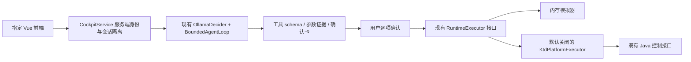

# 自然语言飞控交互交付记录

2026-10-16，Asia/Taipei。当前交付范围是本地可运行的软件候选，已包含Java持久回执及接收来源校验、原会话显式续接、双高度仪表和普通驾驶舱底部布局对齐。真实设备控制、共享部署和正式测试驾驶舱完整视觉验收没有执行。本文保留各阶段记录；最新验证及提交情况见末尾“Java消息来源与回执事务续轮”。

## 任务卡与基线（首轮）

目标：用户以自然语言提出无人机动作，由大模型理解、必要时补参，展示完整动作卡，逐项确认后交给受控执行器；前端使用指定 GitLab `wangxiaolin/lingxi-flight-agent-ui`，物理执行复用 `ktd_backend`。

验收：真实服务/内存模拟器的澄清、预览、确认、取消闭环；动作契约及多输入测试；Java 请求编译、权限/租约/状态门禁、持久幂等与未知回执；前端隔离浏览器点击验证。非目标：任务规划 Agent、直接 MQTT、未核验机型支持、共享环境发布和真机飞行精度结论。

| 项目 | 开工基线 | 工作区 |
| --- | --- | --- |
| 飞控 Agent | `refactor/agent-project-naming` / `c93ab9a67555eb46b448204a1615ab70ff7f0839` | 干净；origin=`git@192.168.110.2:wangxiaolin/lingxi-flight-control-agent.git` |
| 指定前端 | `refactor/agent-project-naming` / `e02eb37`；正式 `main=5e1b319` 为祖先 | 干净；origin=`git@192.168.110.2:wangxiaolin/lingxi-flight-agent-ui.git` |
| Java，只读 | `feature/cockpit-control-proxy` / `dd11a47f91d7bde83a67b09537432dd2453a8a6d` | 干净，未修改 |
| 旧驾驶舱参考，只读 | `feature/cockpit-control-preview` / `b009a80bf1d2755ab41ebd1cddd6ee18922e5125` | 原有合并冲突和用户改动完整保留 |

开发分支两仓库均为 `feature/natural-language-cockpit`。运行身份是本机开发 Agent；Python 3.13.2，Node/Vite 使用现有前端依赖。没有读取或导出平台登录凭据。配置来自命令行和既有 Ollama 默认配置；平台 token 仅允许由服务端注入，不在模型/浏览器/日志中流转。

首轮后端变更集中在 `cockpit.py`、`ktd_platform.py`，以及 `ollama_decider.py` 向后兼容的可选生成上限；新增启动器、三个bench脚本、三个测试模块和输入冻结集。前端变更集中在 `CockpitPanel.vue`、`flightControl.ts`、入口开关、本地代理和测试；旧面板移至 `LegacyPreview.vue` 保留。相关README、接口说明和 `docs/evidence/` 记录交付证据。首轮未修改数据库迁移、Java业务文件或实际运行配置；后续Java候选单独记录。

初始核对预算40次调用/30分钟；实现与复核阶段上限120次开发工具调用/90分钟。模型冻结评测上限100样本、160调用、900秒、2,000,000估算tokens；本地模型提供方不返回费用。真实飞行和共享发布属于独立人工授权节点。

## 调用链与兼容



没有新增另一套 AgentLoop/ToolRegistry。新 HTTP facade 复用原有动作定义、有限循环、CheckpointStore 和执行器；旧 `/sessions/*`、`/api/flight-preview/*`、模拟器及公共导入保持兼容。新交互不使用旧 SessionRunner 自动确认的演示路径。

模型只有提议权：写工具的 handler 永远禁止调用；模型返回动作后由执行器预览。确认直接执行保存的卡，不再次让模型改变参数。复合指令每次只展示一个动作，用户说“继续”才规划下一步，每一步再确认。取消、新意图、会话重置、设备版本或控制权变化使旧卡失效；模拟执行不能升级为真实设备效果。

`ACTION_SPECS` 仍是59项动作契约的来源；交互提议把单次位移进一步限制为0.01–20米。参数必须有用户数值/单位依据，支持中文数词、小数、厘米换算、半米与常见速度表达。明确否定、条件、延迟和能力询问采取保守澄清；该策略不是覆盖所有自然语言的形式证明，模型候选仍需逐项确认。

每次模型循环最多3步，每会话最多30次输入。本地启动入口每次模型HTTP限20秒、每次生成限2048 tokens、最多一次尝试，服务总耗时检查65秒。每tab独立会话；最多64个会话，闲置30分钟回收。模型迟到结果在取消/重置后被丢弃。检查点保存失败不能吞掉已经获得的执行回执。急停等精确安全短语复用原有安全快路径，即使模型不可用也可生成待确认卡；仍要求用户确认。

## 新 HTTP 契约

浏览器只访问 `/api/flight-control`，每页发送随机 `X-Agent-Session`；它只是隔离标识，不是授权。操作者和唯一设备绑定由服务端建立，消息不能携带 actor、任意URL、原始DTO或替换设备。平台模式必须配置可信网关，验证 `X-Agent-Gateway` 和服务端注入的 actor；默认启动器只监听 `127.0.0.1` 并只允许模拟器。

| 接口 | 请求 | 结果 |
| --- | --- | --- |
| GET `/context`、`/state` | 会话头 | 服务端上下文、状态、59项能力及当前可用标记 |
| POST `/agent/messages` | `text,request_id,context_version` | `clarification / preview_required / final / rejected / error` |
| POST `/agent/confirm`、`/agent/cancel` | `confirmation_id,confirmation_binding,command_id,idempotency_key,context_version` | 原动作的结构化回执 |
| POST `/agent/reset` | `context_version` | 旧卡失效；前端成功后轮换会话标识 |

新卡 `expires_at` 是Unix秒。真实Java任务ID可为空，不用任务批次补造。响应包含 `execution_mode,dispatched,device_effect,trace_id`；`device_effect` 始终为 `not_verified`。同请求标识不能更换输入，已被替换的预览不能通过重试复活。平台使用持久 SQLite journal，在发送前记录未知结果；超时、崩溃或重复确认不能自动重发同一指令。

## 本地运行

```bash
# 后端：真实大模型理解，动作只在内存模拟器执行
PYTHONPATH=src python3 tools/cockpit_server.py --port 8794

# 指定前端仓库
cd ../lingxi-flight-agent-ui
npm run dev -- --host 127.0.0.1
# http://127.0.0.1:5173/flight-agent-ui/
```

模拟器以经纬度113/23、航向90度、高度50米的虚构在空状态启动。先输入“申请控制权”并确认模拟接管，再输入“向前飞”→补充“十米”→核对卡片→确认。也可以直接询问状态。旧页面通过 `?mode=preview` 保留。不要把本地模拟器截图或模型回答当作真机飞行证据。

离线浏览器验收使用 `tools/bench/cockpit_ui_server.py` 的明确脚本模型夹具；它只用于检查UI/HTTP/模拟器流程，不能证明模型理解能力。首轮前端沿用蓝色聊天面板和两张素材。用户指出本地源码可用后，已按后文固定正式线重建驾驶舱候选；下载受限不再阻碍本地开发，测试环境当前运行版本仍需独立核验。

## 验证命令与证据

```bash
PYTHONPATH=src python3 -m unittest discover -s tests -p 'test_cockpit.py'
PYTHONPATH=src python3 -m unittest discover -s tests -p 'test_ktd_platform.py'
PYTHONPATH=src python3 -m unittest discover -s tests -p 'test_intent_scenarios.py'
bash tools/ci/offline_tests.sh
PYTHONPATH=src python3 tools/bench/ktd_http_smoke.py

# 模型理解候选：无确认、无平台工具、无飞行
PYTHONPATH=src python3 tools/bench/cockpit_intents.py --live --max-samples 100 \
  --max-model-calls 160 --max-seconds 900 --max-tokens 2000000 --timeout 30 \
  --output docs/evidence/cockpit-intents-20261016.json
```

TDD覆盖了正常路径、补参、非法/超限参数、否定/延迟、取消、超时与预算、过期/篡改/跨会话确认、并发和恢复、操作者/资源/权限/控制权变化，以及平台状态与发送结果分层。模型冻结集为100条合成输入、17类、覆盖57/59个动作；未覆盖上传航线和投放器。没有独立人工或飞行真值，业务准确率 `not_evaluable`；只报告合成契约匹配及逐类分母，错误/超时/缺失保留。

首轮评测工具在发送前因缺失 `num_predict` 报错，实际模型调用0，保留在 `evidence/cockpit-intents-harness-error-20261016.json`。修复后新增贯穿真实解码器/传输边界/循环的回归测试，再冻结运行；这份失败记录不属于模型能力评测。

| 验证层 | 结果 | 证据边界 |
| --- | --- | --- |
| 后端全量离线 | 398项通过 | 含整套禁止socket连接的守护测试 |
| 前端契约/状态测试 | 46项通过 | 原预览兼容 + 新交互、安全边界 |
| 前端构建 | Vue/TS检查、Vite构建通过 | 当前指定仓库，非共享部署 |
| 浏览器，HTTP夹具 | 12类场景通过 | `evidence/cockpit-ui-fixture.json`，0越界请求/浏览器异常 |
| 浏览器，真实服务+模拟器+脚本脑 | 5类场景通过 | `evidence/cockpit-ui-service.json`，10次API/2次确认，0设备请求 |
| 浏览器，真实qwen3.5:9b+服务+模拟器 | 第2次尝试5类场景通过 | `evidence/cockpit-ui-live-model.json`，10次API/2次模拟确认，0越界/设备请求；首次失败另保留说明 |
| Java HTTP传输回环 | 通过 | 2个本机假服务请求，0平台请求；验证固定请求编译和不跟随重定向 |
| 模型候选首轮 | 分母100：76匹配、7不匹配、8超时、9缺失 | `evidence/cockpit-intents-20261016.json`，900秒预算，94次模型调用，无确认/业务动作 |
| 模型候选补跑 | 仅原9条缺失：4匹配、5超时 | `evidence/cockpit-intents-supplement-20261016.json`，独立时间窗；报告仍保留100分母，其余91条为未选样本 |

首轮逐类分母保存在JSON中。7项不匹配包含4项“否定输入得到澄清”这种保守分类差异；另有“执行上传航线”被理解为恢复航线，以及“十来米”被当作10米、条件返航被处理为只读状态查询。报告的 `unsafe_action_proposals=2` 中只有1项是移动提议，另1项为只读查询，不能称作2次危险执行。真实服务对这两项均有独立重放测试并拦截；航线语义混淆仍是模型候选已知限制，不自动纠正为成功。

首轮p50约6.70秒、p95约30.01秒；超时调用的token使用量未知，已知部分为320902输入/11590输出，费用未提供。首轮输入、标签、模型、prompt、工具schema与源文件哈希均记录且运行期间未变化。后续修复只涉及交互策略/会话和回执边界，未改变该轮所用提议registry、模型prompt和解码器；这些改动另由离线回归验证。补跑仅针对首轮9条缺失输入，使用同一输入/标签/prompt/schema/模型设置，另存报告，不覆盖原来的7项不匹配或8项超时。

两次窗口的输入、标签、prompt、schema和模型options哈希/内容均已比较一致；100个不同输入最终都尝试过，总计80匹配、7不匹配、13超时。匹配中有1条由现有输入护栏直接拒绝，不能称作模型作答；合计103次模型调用，确认、平台请求和实际设备动作均为0。超时是已知待改进项，不能从分母剔除，也不能把80/100称作真实业务准确率。当前只冻结模型tag，未取得权重revision证明。

真实模型浏览器首次尝试在“申请控制权”未获得动作卡，页面保持未持有控制权且没有确认/执行；随后同一服务直接提议请求与独立循环诊断均返回 `control_acquire` 待确认，`done_reason=stop`。首次错误未记录细分模型原因，不能断言是超时，也不能把后续成功覆盖为始终稳定。固定脚本模型的UI测试不包含此类模型可用性问题。

第2次真实模型浏览器闭环通过：申请控制权并确认→“向前飞”得到距离澄清→“10米”产生前进10米卡→确认模拟移动→拍照卡取消→新会话。根Agent目视复核了 `evidence/cockpit-ui-live-model-confirmation.png`，并另从服务读回位置/状态；这仍是虚构资源上的软件闭环，不是Java或真机执行验收。

首次交付前端已提交并推送 `6dbb5182ba2b00891e01a9dd47a4cd62e66f42d3`，后端为 `eec1631992a27f51ee42eb50f5965a3036b486cb`，均已核验远端SHA。两个GitLab origin保持不变，未创建合并请求，未同步未映射的个人仓库。

## 2026-10-16 续轮：错误分类、航线状态和延迟诊断

本轮以前述两个提交为基线，仍在 `feature/natural-language-cockpit` 开发。目标是复现首轮暴露的模型失败和航线边界，交付可回归的本地候选，不扩大到 Java 写入或共享部署。运行身份仍为本机开发与合成测试操作者。诊断预算为8次模型调用、300秒总时限、单次35秒和2048输出tokens；离线开发复核分阶段限30次检查/30分钟，交叉复核发现两项缺陷后追加一轮。费用未由本地模型提供方报告。输入来源是既有冻结集中的4条、合成服务回放和现有源码；旧评测结果没有覆盖或重打标签。

错误响应新增稳定的 `MODEL_TIMEOUT`、`MODEL_OUTPUT_TRUNCATED`、`RUN_BUDGET_EXCEEDED` 分类，其余失败保持 `MODEL_ERROR`。生成达到长度上限时，即使响应中有完整工具字段，也拒绝提议且不重试。驾驶舱在错误进入checkpoint前替换成固定文案；原生HTTP错误仅保留状态码、不读取响应正文，模型错误信封不再保存到 `last_raw_response`，因此旧AgentLoop入口也不会把这些上游错误原文写入会话。前端按错误码给出中文原因、清除旧卡，不自动重试或确认；确认请求发生不明结果时仍维持原有 `unknown` 语义。

航线启动、暂停、恢复现在分别要求已有航线处于 `uploaded/running/paused`。确认绑定航线身份、状态、断点和操作代次；同ID重传、状态往返、另一个会话急停/返航/降落、释放后重新获取控制权均不能复活旧卡。相机操作仍可与待确认航线卡共存。规则、TDD反例及边界见 [航线状态说明](route-state-safety.md)。旧 `route_06` 输入继承了已暂停状态，存在“启动/恢复”上下文歧义；原来不匹配的记录仍保留，不把执行器拒绝算作模型正确。

两项交叉复核缺陷均先通过失败测试复现，再实现修复：另一会话急停后旧恢复卡仍能执行，以及旧Agent入口保留上游错误正文。当前全量离线回归为 **429/429**，前端为 **51/51**，Vue/TS及构建通过。前端离线浏览器现覆盖16类场景、33次夹具API请求，0越界/设备请求、0浏览器异常；四类新错误均验证固定提示、旧卡清空、原始错误隐藏，返回后500毫秒内没有自动重试或确认。根Agent检查了代码、JSON与[超时提示截图](evidence/cockpit-ui-model-timeout-20261016.png)。新增浏览器记录见 [错误界面证据](evidence/cockpit-ui-failures-20261016.json)，其中临时截图路径保留原值，超时截图另按原字节保存到仓库。

```bash
PYTHONPATH=src python3 -m unittest discover -s tests -p 'test_model_failure_codes.py'
PYTHONPATH=src python3 -m unittest discover -s tests -p 'test_route_safety.py'
bash tools/ci/offline_tests.sh
# 前端仓库：npm test；npm run build；env -u COCKPIT_API_URL npm run e2e:cockpit
# 下列诊断只调用模型，不确认、不执行工具；输出路径必须尚不存在
PYTHONPATH=src python3 tools/bench/cockpit_latency_probe.py --live --output /tmp/cockpit-latency-new-run.json
```

延迟诊断采用同一输入/上下文、prompt、工具定义及模型设置，唯一请求变量为默认思考与 `think=false`，交替执行顺序。[原始8次结果](evidence/cockpit-latency-probe-20261016.json)中7次返回、1次35秒超时；没有确认、平台请求或设备动作。Ollama版本为0.21.0，模型 `qwen3.5:9b`，前后权重digest均为 `6488c96fa5faab64bb65cbd30d4289e20e6130ef535a93ef9a49f42eda893ea7`。

| 合成输入 | 默认思考，单次决定 | 关闭思考，单次决定 |
| --- | --- | --- |
| 向前飞10米 | 22.91秒，前进10米 | 2.92秒，前进10米 |
| 把机头转向那栋楼 | 9.29秒，文本结束、无工具 | 4.20秒，文本结束、无工具 |
| 向前飞 | 5.87秒，要求澄清 | 3.19秒，自行补成前进10米 |
| 向后飞负5米 | 35.01秒，超时 | 3.18秒，忽略负值而提议后退5米 |

首次默认请求含12.51秒模型加载，运行前目标模型未驻留、运行后已驻留；这证明冷加载影响了该次请求，不能据此断言首轮浏览器失败的唯一原因。默认模式仍有一个超时，生成耗时和冷加载都值得分别观测。关闭思考虽更快，但出现缺参猜测和负值改写，因此**没有改变模型默认设置**。该实验每输入仅一对，运行在共享模型服务，没有随机化或独立硬件；它不是完整循环A/B准确率评测。7个返回的已知用量为26086输入/619输出tokens，超时的用量未知。

该诊断原报告记录了fixture/prompt哈希和模型digest，但未记录源码/tool-schema哈希，且运行时工作区包含在途修复，因此仅作为诊断线索。诊断脚本现已补上运行前源码、工具、上下文与配置哈希及运行后变化检查，并拒绝覆盖旧证据；未为补元数据重跑或改写旧报告。本轮digest也不能反向证明原100条评测时的权重版本。原80匹配/7不匹配/13超时仍属于原版本的两个窗口，不构成本轮当前业务准确率。

仍有限制：总耗时在模型调用前后检查，不能抢占已经阻塞的HTTP调用；单次HTTP另有超时。`continue_from_breakpoint` 自身状态契约未在本切片扩展。直接用多个线程共享裸模拟器时仍有检查/执行原子性缺口；当前单个Cockpit服务锁覆盖此路径，不承诺跨进程共享执行器安全。完整真机流程和测试环境视觉一致性继续缺少证据。

## 2026-10-16 本地源码续轮：完整驾驶舱与Java快照接入

本轮基线为后端 `136b692`、指定前端 `ea682fa`，仍在 `feature/natural-language-cockpit`。用户指出本地源码可用后，已补查Java主项目并核验现有缓存；前端采用 `onegismap_a-b4-20260910` 内正式主线 `35574cba46d498e0992de05504756bccf7014ade`（10月12日），Java候选从本地缓存正式线 `98a8da4`（10月9日）建立独立 `feature/flight-agent-platform-snapshot` 工作树。远端下载失败不再作为本地候选开发的前提；缓存不称作远端最新。原主目录、旧前端冲突和未提交文件均未改动。

目标是把本地源码转成可审查的完整界面候选及Java读取链路；本轮预算60分钟/120次开发检查，后续增加10分钟Java最终编译核验。运行身份为本机开发/离线测试，权限范围为本地源码、测试、构建和现有开发分支提交。输入仅来自固定源码、合成快照和UI夹具；没有真实平台登录、设备、业务写入或共享部署。

指定前端新增完整驾驶舱外壳：顶部、左右355px设备/遥测区、中央位置/视频区、底部飞行及载荷控制台、专业/简控切换、可收起助手。16件原素材从固定主线Git对象逐文件导出，来源和哈希记录在前端 `src/assets/cockpit/SOURCE.json`，未使用脏工作区或test独有代码。全页只创建一个 `CockpitSession`；手动“前进7.5米”与聊天共用提议、确认、取消和上下文，不自动确认，不直接调用Java/MQTT。平台 `yaw_deg` 与模拟器 `heading_deg` 均能显示。

位置来自服务快照，缺失电量、链路和姿态显示“未提供”；地理底图、直播、持续摇杆/键鼠仍未接入。简控是按本地主线重建的候选，**不是测试环境完整视觉/业务一致性已通过**。根Agent已目视复核[桌面专业布局](evidence/cockpit-workspace-desktop-20261016.png)、[共享动作卡](evidence/cockpit-workspace-confirmation-20261016.png)及手机截图；[浏览器JSON](evidence/cockpit-workspace-ui-20261016.json)保留原临时截图路径。

Java新增只读快照候选，Python新增严格 `KtdSnapshotProvider`、固定快照GET和独立 `platform_cockpit_server.py`。配置仅来自服务端环境，默认只读；平台写动作必须同时满足显式开关、权威许可和逐项确认。Java合成响应已经跨语言解码，并通过两个脚本自建的回环HTTP服务贯通Agent会话，拒绝结果没有被模型或启动开关覆盖。详细契约、环境变量和当前拒绝原因见 [平台接入说明](ktd-platform-contract.md)。

| 本轮验证 | 已核验结果 | 范围 |
| --- | --- | --- |
| Python完整离线回归 | 458项通过 | 含新增20项快照、9项运行装配；全套socket守护仍通过 |
| 前端单元/契约测试 | 60项通过 | 共享会话、手动提议、遥测未知值、平台航向及服务端代理身份 |
| 前端构建 | Vue/TS/Vite通过 | 未发现服务端测试凭据进入客户端bundle |
| 前端离线浏览器 | 22类场景、37次夹具API，0越界/浏览器异常/设备调用 | 1920×1080完整布局、414×747原流程及旧preview入口 |
| Java候选 | 8模块离线Maven reactor构建成功，17项指定测试通过 | 真实Controller/Service和遥测投影；不启动Spring业务上下文 |
| Java响应→HTTP→Agent | 3次Agent HTTP、5次快照GET、1次脚本模型决定，0控制POST | 使用真实Java序列化的合成响应；不是在线Java或真机验证 |

本轮没有重新运行100条真实模型评测，不将新工程检查叠加为识别率提升。Java源码侧的构建和验证记录随其独立候选交付；非空taskId目前仅支持代码5的固定机场任务，跳飞等类型需要另外核对实时机场来源。完整Spring运行、真实数据读回、线上页面和设备效果仍未验收。

Java候选已本地提交为 `c06398bb8d84dfd0d07dbaf64ced4ab64f80ee55`，分支 `feature/flight-agent-platform-snapshot`；推送被GitLab明确拒绝为“not allowed to push code”，本地提交和完整工作树保留。前端本轮提交为 `46c0bcc8fb9000c540c9fcba3785d3c10229eb0c`。Python交付以当前分支最终Git记录为准；每个仓库的推送结果独立核验，不因Java远端拒绝回滚其他已验证成果。

## 2026-10-16 追加切片：原始遥测来源与快照时间

任务卡：以Agent `2bc3be1`、前端 `46c0bcc`、Java `c06398b` 的干净开发目录为基线，补齐原始报文同帧投影及界面的快照时间提示。输入只来自已核验的本地协议解析源码和合成报文；输出为兼容旧快照的Java/Python代码、UI提示和离线测试。运行身份为本机开发进程；预算30分钟，Java最多60次开发工具调用，前端最多40次。允许本地文件、测试和开发分支提交；不启动Java业务应用，不使用真实设备或平台数据。部署、取航权、发心跳和设备动作仍是后续需要明确授权的节点。

验收关注同帧缺字段不回填旧缓存、协议固定时间单位、来源与资源匹配、离线事件失效、旧API兼容，以及界面读取失败和时间推进时的文案。原报文timestamp称“协议上报时间”，入口时钟称“处理入口接收时间”；两者都不是已校准传感器采样时刻的独立证明。帧完整性不能代替航权、控制链路或动作完成证据。

Java已在实际DJI/PZ处理入口保存不可变原帧投影，独立缓存最多4096设备；错误时间、同时间冲突、重放、乱序和显式离线不会刷新为在线。真实Repository在冷启动或容量淘汰后缺帧时返回 `TELEMETRY_FRAME_UNAVAILABLE`，不回退到旧合并缓存。容量淘汰及无帧离线使用有界的新帧时间边界，代价是新入缓存设备可能需要等待更晚的一帧。旧公共读取方法、Source默认重载及旧响应样本仍兼容。

Python独立验证原帧元数据、资源profile、时间、完整声明与状态字段；[Java生成的原帧响应](../fixtures/ktd-platform-raw-snapshot-v1.json)已跨语言解码，[来源记录](../fixtures/ktd-platform-raw-snapshot-v1.provenance.json)绑定Java提交和16个源码哈希。完整帧只解除字段时效这一项拒绝，仍不开放任何写操作。

额外核对DJI官方文档后，增加距离动作的相对高度校验：当前低于20米会触发厂商隐含爬升，必须拒绝；目标相对高度低于20米按项目未核验行为拒绝，目标椭球高须在2–10000米。PZ不套用该规则。缺少真实高度来源时不猜测。官方依据与错误码见 [接入契约](ktd-platform-contract.md)。这项新发现及最终归档追加10分钟预算，没有增加设备或平台权限。

## 指令跟踪与回执切片任务卡（2026-10-16）

目标为已确认的 DJI 六方向距离指令保存实际发送标识，分开提交结果与设备报告，并允许原会话在设备报告完成、重新读取状态后手动继续。验收覆盖 Java 持久化及原始报文解析、Agent 重启后只读查询、UI 独立回执展示、并发和失败路径；继续仍需新确认卡。基线为 Agent `ef163ece`、前端 `f037baf0`、Java `8cc7f145`，沿用各自语义开发分支。输入为固定源码、厂商官方协议和合成报文；输出为兼容旧接口的代码、测试与契约说明。

本切片及接续复核使用 TDD，剩余开发预算为90分钟、120次开发工具调用；运行身份为本机开发进程与合成操作者，模型调用预算为零。允许本地源码、临时数据库、回环HTTP与浏览器夹具、测试、开发分支提交和已有权限内推送。Java 远端推送已被拒绝，保留本地提交；不反复尝试绕过权限。非目标为其他厂商回执、真实航权建立、设备执行和共享发布；Java业务应用、真实MQTT、业务库与共享环境不启动、不写入。部署DDL、开启控制与真实设备验收是后续人工节点。

## 回执切片交付（2026-10-16 15:19，Asia/Taipei）

已实现“原确认 → Java耐久提交 → 设备报告关联 → 手动查询 → 原会话显式继续 → 新确认卡”。实际厂商发送标识在日志提交前生成、提交后按同一报文发布；未知结果不自动重发。Java全局Fastjson的空值转空串问题通过局部serializer修复，原业务对象规则保留。实际飞点枚举按官方 `wayline_*` 校验，不把受理或剩余距离0当完成。

复核修复了提交响应丢失版本证据、跨任务绑定回放旧确认、迟到线程覆盖已知报告、同版本到期投影、HTTP宽松类型转换、资源改绑和设备SN变化未进入快照版本、跨项目同机互斥、外层事务未提交就发布、Java高度与距离边界。请求和执行仍复用原Agent循环、Java操作实现和MQTT入口；没有新建另一套Agent。

前端补充独立设备回执区域，并区分绝对高度与相对高度。两者分别取 `altitude_m/height_m`，不相互补值；零值保留，缺失和非法值显示未知。旧ASL/ALT标记不宣称椭球高已转换为海拔。前端主产品未新增网络入口、地图SDK或播放器。

| 验证层 | 最终结果 | 输入及证据范围 |
| --- | --- | --- |
| Python全量离线 | 500/500 | `bash tools/ci/offline_tests.sh`，包含禁止外部socket的守护测试；新增34个回执/会话/并发测试方法 |
| Java候选 | 78/78；11模块编译成功 | inspection75、visualization3；真实Mapper/XML、H2、原操作类、原处理器、MockMvc及HTTP converter；没有启动业务应用 |
| 前端单元测试 | 92/92 | 回执24项、双高度2项及原66项；合成HTTP边界 |
| 前端构建 | 通过 | Vue/TypeScript与Vite生产构建 |
| 浏览器 | 53类通过 | 122个夹具API请求、21次夹具确认；0越界请求、0浏览器错误、0设备请求 |
| 跨语言回环HTTP | 通过 | Java实际序列化原样本先独立解码，再明确合成身份/许可驱动22次Agent HTTP、16次快照GET、6次回执GET、1次控制POST；继续只产生第2张卡 |

回环测试的2次模型调用是 `OllamaDecider` 的合成transport决定，实际模型请求0。没有重跑模型评测；之前100条合成输入的80匹配、7不匹配、13超时仍保留原分母与来源，不能改称500/500意图准确率。设备效果、真实位移精度和业务准确率仍为 `not_evaluable`。

回执原样本为 `fixtures/ktd-command-receipt-v1.json`；相邻provenance固定Java提交 `728b9d34ddaf3995739a98e34bcae55097394a30` 和字节哈希，仅比Java生成文件多一个换行。旧快照样本及其历史来源没有覆盖。验证摘要与源文件哈希见 [本轮证据](evidence/cockpit-receipts-20261016.json)。

```sh
bash tools/ci/offline_tests.sh
PYTHONPATH=src python3 tools/bench/command_receipt_smoke.py
# 前端仓库
npm test
npm run build
npm run e2e:cockpit
```

Java完整Maven命令和DDL路径见其 `docs/flight-agent-platform-snapshot.md`。本轮前端提交 `27d8ef7`（回执）和 `7271283`（双高度）；Java提交 `728b9d3`仅本地保留。Agent与前端仍使用 `feature/natural-language-cockpit`，Java使用 `feature/flight-agent-platform-snapshot`；不合并test、不创建合并请求、不部署。

变更文件：Agent新增 `command_receipts.py`、三个回执测试、Java原样本与provenance、回环smoke；修改 `cockpit.py/ktd_platform.py/platform_runtime.py` 和装配测试。前端修改 `flightControl.ts/CockpitPanel.vue`、驾驶舱高度投影/样式、测试和README。Java新增 `flightcommand` 类型/服务/mapper/DDL及测试，局部修改snapshot、既有POST/MQTT入口、位移提交注入与空值序列化。完整文件列表保存在对应提交中，原Java主目录、b3副本和旧前端冲突未改动。

当前仍未完成原目标的全部环境验收：真实Java策略继续返回厂商航权/链路未知且距离能力关闭；实际MySQL迁移与事务装配没有测试；测试环境地图、视频及当前部署版本尚未对照。已从本地正式线定位地图配置和视频描述来源；旧启动推流接口有设备副作用，不能当作只读播放直接调用。后续可继续实现只读地图/播放描述适配，但真实影像与视频一致性需要目标环境的可访问描述，真实飞行需要独立的航权/链路事实和隔离验收授权。

回退使用新提交的独立revert或关闭Agent控制与Java tracking开关，保留未知命令及审计表；不自动删表、重发或重置共享历史。允许的副作用仅本地代码/测试、临时H2/SQLite与回环服务、开发分支提交推送；真实设备动作、共享业务写入和部署均为0。

## 地图与播放描述切片任务卡（2026-10-16）

目标为用旧正式线的地图资源替换纯坐标示意，并接入当前资源已有的视频播放描述，向完整测试驾驶舱交互靠近。验收包括可实际渲染的地理底图、当前位置/航向/定位、已存在媒体的只读播放与停止、资源切换和错误隔离；模型仍只提议飞行动作，地图操作和视频地址不进入模型工具。基线为Agent `3d72d57`、前端 `7271283`、Java `728b9d3`，三开发目录干净；旧前端未解决冲突保持原样，只用固定正式线 `35574cba` 读取。

输入来自固定旧组件、现Java只读接口及公开第三方依赖；输出为向后兼容的展示契约、组件、离线测试和来源清单。模式为本地候选，运行身份为开发进程和合成测试用户；预算90分钟，root最多120次开发调用，协作单元各自记录预算；真实模型调用预算0。允许源码、可复现静态资源导出、依赖安装、临时媒体夹具、回环服务、开发分支提交推送。非目标为自动启动设备推流、设备控制、共享环境部署和把离线全球底图冒充详细测试环境影像。需要真实流/图层和测试页面对照时，使用已授权的只读资源；开启推流、取航权、迁移业务库和真机验证仍需另行明确授权。

前端显示快照时间与距今时长，区分读取失败、未知时间、未来时间、不可用和模拟状态。读取失败保留原确认卡；显示时钟不发送请求，卸载清理定时器。根Agent已查看[读取失败截图](evidence/cockpit-telemetry-read-failure-20261016.png)和手机确认流程；[浏览器证据](evidence/cockpit-telemetry-ui-20261016.json)记录时长2→13秒、显示时钟0请求、卸载定时器2→0。

| 追加切片最终验证 | 结果 |
| --- | --- |
| Python完整离线回归 | 466项通过；含25项快照、33项平台执行器，socket守护通过 |
| 前端测试与构建 | 66项通过，Vue/TypeScript/Vite通过 |
| 前端离线浏览器 | 28类场景、44次夹具API；0越界、0浏览器异常、0设备请求 |
| Java完整离线Maven reactor | 8模块成功，38项指定测试通过；不启动Spring业务应用 |

本切片的公开复现入口仍是 `PYTHONPATH=src python3 -W error::ResourceWarning -m unittest discover -s tests -p 'test_*.py'`，前端 `npm test`、`npm run build`、`npm run e2e:cockpit`；Java完整命令在其 `docs/flight-agent-platform-snapshot.md`。仅HTTP边界、数据库事实源、时钟及旧消息外部存储/推送被替代，核心解析、缓存、Controller/Service、Python提供器和UI会话为真实实现。模型100条合成评测没有重跑，原80匹配、7不匹配、13超时结果不变，不将工程测试折算成模型或飞行准确率。

前端提交 `f037baf0ce2de6f32dc2839e32358c8841a8526d` 已推送并核验远端。Java追加提交 `8cc7f1452d52c18d659777833053eb1c7cb58eb7` 保留本地；同一仓库此前已明确拒绝推送，本轮没有反复尝试或绕过权限。Agent提交以本分支最终Git记录为准。没有个人GitHub源码同步映射，未创建额外同步仓库。

## 尚未闭合的真实环境条件

详见 [Java契约核对](ktd-platform-contract.md)：当前候选已包含经过资源鉴权的原帧快照、受限距离提交和可关联的设备报告；正式环境尚无这条新链路的运行证据。起飞高度基准、偏航角度和当前点降落不能强行映射，调试OSD接口不作为权威快照替代。HTTP200仍不能标记设备完成，新回执实现只在合成报文上验证过。

首轮因远端下载受限未修改Java；现已使用本地Java和旧前端正式线完成独立候选、原帧入口、回执跟踪及展示适配。Java当前仍不能证明厂商航权、控制链路持续有效或真实设备时钟/高度基准，因此控制动作仍拒绝，距离能力仍为false；新鲜 `read_state` 与独立媒体描述可分别读取。还需补齐这些真实来源、核验执行前授权的实际装配、取得真实回执样本，再在隔离资源上进行获授权的集成、人工界面及设备验收。不能通过手动把capability改为true或把当前HTTP时间当作遥测时间来完成目标。没有共享部署、真实平台/设备请求、dev-wxl/test合并或合并请求。

回滚：不启用平台执行器；前端设置 `VITE_FLIGHT_AGENT_MODE=preview` 返回旧预览入口，或回退本功能提交。新服务停机后未执行卡失效。已经提交的真实指令不可能靠回退代码撤销，持久journal必须保留；本轮没有真实提交。

## 地图与媒体切片交付（2026-10-16 16:56，Asia/Taipei）

本段为本次最新验证结果，前文各轮测试分母保留历史含义。已使用本地Java项目 `/Users/wangxiaolin/IdeaProjects/ktd_backend`、较新缓存正式线 `/Users/wangxiaolin/PycharmProjects/ktd_backend-b3-java` 和旧前端 `/Users/wangxiaolin/PycharmProjects/onegismap_a-b4-20260910` 作为源码依据；原目录的未提交和冲突文件均未修改。Java候选仍位于独立 `ktd_backend-flight-agent-snapshot`，基于已缓存核验的`prod@98a8da4`，不宣称已经下载到GitLab最新prod。旧前端只读取固定正式线`35574cba`，没有搬入test独有历史。

前端现在实际渲染本地Cesium 1.92与NaturalEarthII，包含位置、航向、定位、未知值清理和WebGL降级。地图95个运行文件共15,756,271字节，许可证68,756字节，源提交与逐文件哈希均固定；第三方原始空白通过目录级Git属性保留，自有源码空白检查通过。它是低分辨率全球地理底图，无地形、无详细测试环境影像，也未校准真实坐标精度。[地图与确认卡](evidence/cockpit-map-confirmation-20261016.png)已由根Agent目视复核。

视频使用独立“读取已有描述→选视角/来源→播放→停止”流程，Java复用快照原有资源授权后读取持久字段，Python再校验绑定、来源白名单及期限。没有添加模型工具或新Agent循环；仍是原59项工具与确认/回执路径。前端地址不进入聊天/模型/检查点，初始化及场景切换不取流，读取不会自动播放；上下文、会话、候选变化、过期、停止与卸载均清理播放器和迟到请求。Java与Agent成功/失败媒体响应都显式禁缓存，前端媒体请求不携带业务凭据。[视频页面](evidence/cockpit-video-workspace-20261016.png)及1280宽度已复核无助手重叠，414宽度只验收原助手流程。

TDD先复现再修复同格式多来源被拒、长期有效期未设停止计时器、RTC的HTTP来源无法约束SDP地址、Java原始接口缺失no-store。RTC限已核对的ZLMediaKit只收视频协议，SDP候选必须与信令源字面IP一致；这不构成UDP网络隔离。HLS/FLV/MP4及本机RTC均用真实浏览器解码验证，具体限制见 [媒体契约](visuals-media-contract.md)。Java旧实体查询在缓存miss时会回填Redis，故无启流/控制/业务实体写不等于实际环境零缓存写。

| 验证层 | 已核验结果 | 证据范围 |
| --- | --- | --- |
| Python全量离线 | 521/521，新增媒体21项 | 原有回执/确认/并发与socket守护保留；无真实模型调用 |
| Java候选 | 99/99，11模块成功 | inspection96、visualization3；新增媒体21项中HTTP缓存3项覆盖5种R.code；未启动业务应用或完整认证过滤链 |
| 前端单测/构建 | 107/107；Vue/TypeScript/Vite通过 | 新地图3项、媒体12项及原92项 |
| 完整页面浏览器 | 73类通过，149次夹具API，21次夹具确认 | 原55类全部保留，新增媒体18类；11个本机媒体请求为10次主动取消+1次预设403；0页面越界/浏览器错误/设备调用 |
| 实际地图渲染 | 本地瓦片与worker加载、真实坐标/航向/相机、卸载及WebGL降级通过 | 独立renderer状态与截图；页面定位只改变相机 |
| 实际媒体播放 | 16/16 | MP4/HLS/FLV各18解码帧，RTC14帧且时间递增；停止/切换/取消、跨源分段和密钥、重定向及坏ICE均按预期处理 |
| 跨语言契约 | Java原样本→Python公共DTO→真实UI解码通过 | 8字段与资源绑定正确，签名原文保留；无真实URL读取 |

冻结记录为 [总证据](evidence/cockpit-visuals-20261016.json)、[完整UI](evidence/cockpit-visuals-ui-20261016.json)、[地图](evidence/cockpit-map-20261016.json)和[播放器](evidence/cockpit-media-20261016.json)。视频播放验证仅使用本地ffmpeg生成片段和canvas的真实PeerConnection；没有直播平台、摄像头或麦克风。完整UI中的悬挂媒体只验证取消生命周期，不当作解码证据。首次源码检查出现的第三方空白告警保留原字节并单独标记vendor，没有格式化来源SDK。

复现命令：Agent `bash tools/ci/offline_tests.sh`；前端 `npm test`、`npm run build`、`npm run e2e:cockpit`、`node scripts/map-e2e.mjs`、`node scripts/media-e2e.mjs`。Java完整离线Maven命令和各次红绿结果见其 `docs/flight-agent-platform-snapshot.md`。本轮未重跑模型评测，原100条合成输入仍为80匹配、7不匹配、13超时，不能把工程测试当成识别率或业务准确率。

变更范围：Agent新增`ktd_visuals.py`、两个媒体测试、Java样本/provenance及本文证据，局部修改cockpit、KTD transport、平台装配和HTTP响应头；前端新增地图/视频组件、受限播放器、固定第三方资源及三组验证脚本，局部接入原共享客户端/Workspace；Java新增`platformvisuals`与共享资源授权器，保留原快照鉴权语义。本切片期间已有独立文档规则提交`e10d2d6`，已保留，没有覆盖或夹带其文件。

前端提交`b3a29d877a20d7b12f57eaa86eb6a3f4463268bf`已推送并核验SHA；Java提交`57c96a5ca9f117c0668c8ad6ae2fb7fb8a3d8bcb`仅本地保留，不重复尝试已被拒绝的push。Agent提交以本分支最终Git记录为准。允许的副作用仅本地开发/合成数据/回环测试与已有授权的开发分支推送；共享部署、真实平台/媒体调用、设备动作和业务数据库写入为0。没有个人GitHub同步映射。

原目标仍缺测试环境当前版本的实际对照、真实媒体服务鉴权/CORS/编解码与有效期证据，以及厂商航权/持续链路/隔离设备的执行验收。真实飞行与绝对精度保持`not_evaluable`。关闭媒体来源白名单可停止返回新播放候选，已打开浏览器需停止/刷新；撤回本切片提交可恢复旧展示路径，无新增数据库迁移，不能删除前轮命令journal或把未知命令自动重发。

## 意图澄清与控制链路缺陷任务卡（2026-10-16）

目标为修复真实请求链中的补参状态丢失、明确动作与否定约束混淆、等待口令漏识别，以及已定位的Java DRC主题/心跳缺陷。验收穿过真实Ollama协议解析、Cockpit会话/确认和既有Java消息逻辑，外部模型/发布边界使用合成输入；评测保留原100条输入与标签，分开统计只读提议、危险写提议、模型超时与总预算截断，不将旧报告当作当前闭环结果。

基线为Agent `c807bf2`、UI `b3a29d8`、Java `57c96a5`，开发目录均干净，沿用语义分支和固定配置。输入为现有100条冻结集、实际源码、独立新增回归输入及测试平台公开静态资源；输出为局部修复、测试和证据。模式为本地候选，运行身份为本机开发和合成评测操作者。root预算60分钟/120次开发调用；若执行新模型候选评测，仅使用原Ollama、合成输入、最多160请求/1800秒/200万预留token，费用由本地provider未提供时记录未知。协作单元各自限定预算，互不改写同一代码文件。

允许本地代码、测试产物、临时静态文件与开发分支提交推送；测试环境仅请求不带凭据的首页及明确静态依赖，不执行其脚本或进入会启流的机库页面。不启动Java业务应用，不连接真实MQTT/业务库，不开启控制或修改能力为true，不部署、不改原评测标签。真实设备、共享发布、带业务副作用的界面验收仍需明确隔离范围及授权。本轮继续使用TDD；先以实际失败建立回归，再实现和冻结验证。

### 原评测记录的口径复核

旧80匹配/7不匹配/13超时保留原样；其中4个否定输入的标签要求`no_action`，原prompt却要求“先澄清”，不能将其全部解释为模型执行误判。`missing_07`把“十来米”补猜成10，确有模型错误，但当前服务门禁已拦截该输入。`conditional_01`只有`read_state`，旧`unsafe_action_proposals`把只读提议和写提议混计；新报告保留此历史计数，另增`unsafe_mutating_action_proposals`和`unexpected_read_only_action_proposals`，不静默改旧分母或结论。

原冻结集`route_06`要求“执行已经上传的航线”，却继承`route_status=paused`且无独立override；`execute_route`要求uploaded，`route_resume`要求paused。这是输入与状态契约冲突。样本、期望和旧不匹配结果均保留，不把更换标签算改进；后续版本须分别提供uploaded启动、paused恢复和状态冲突澄清的独立输入。

旧`limits_05`的14.128秒中断发生在900秒总预算结束处，不能继续只归为模型请求超时。新脚本在总预算到期时将已尝试样本记为`uncertain/run_budget_exhausted`；单请求超时仍为`timeout/model_timeout`，剩余未尝试样本仍为missing。另12条约30秒的超时缺少加载、排队和生成分项，不能断言换模型或关闭思考就能解决。

### 当前测试部署的静态版本核验

从本地配置与历史验收记录定位原平台为`https://lxtest.zhuoyilingxi.com:8088/AFMAP/`，与独立旧预览部署`http://192.168.110.17/flight-agent-ui/`区分。2026-10-16仅GET首页及6个明确引用的同源JS/CSS，共4,537,806字节；无Cookie/Authorization、不跟随重定向、不关闭TLS校验、不执行脚本、不登录、不访问业务API、MQTT或设备。根Agent核对了全部文件SHA256，见 [静态版本证据](evidence/cockpit-test-deployment-static-20261016.json)；原始bundle只保留临时目录，没有纳入本仓源码。

当前入口`index-DPadamzi.js`将hangar路由指向`index-CO_tJEWL.js`。进一步核对父组件后，确认`HybridControlCenter/HybridControlCenterSimple`仅在`siteData.uavType===HybridWing`或`uavTypeName`包含“复合翼”时选用；其他类型仍选用`maintenanceRecord-D7yDEbKp.js`中的`ControlCenterView/ControlCenterSimpleView`。固定正式线`35574cba`也使用这套普通组件名。因此，仅在bundle中发现Hybrid代码，不能判断DJI/PZ驾驶舱已换版。19/20/23m/s速度预设、备降和相关3×2布局属于复合翼分支，不能复制成普通无人机的能力或参数边界。实际站点类型、完整发布SHA及像素一致性仍未核验。

视觉参考的运行边界补充：可在临时目录离线执行已下载的控件，使用临时浏览器profile、本地拒绝代理和页面请求白名单，只允许本机静态资源，全部平台API、MQTT/WebSocket及外部连接均拒绝；业务上下文只允许明确标注的合成夹具。此本机隔离渲染不构成线上页面访问、机型能力核验或设备验收，不读取登录凭据。静态GET总预算继续为20文件/50MiB，渲染定位预算20分钟/40开发调用。

后续累计18个静态文件、7,074,101字节，逐文件哈希及分支选择见[完整来源清单](evidence/cockpit-test-components-20261016.provenance.json)。已隔离渲染的[专业](evidence/cockpit-test-hybrid-professional-synthetic-20261016.png)和[简控](evidence/cockpit-test-hybrid-simple-synthetic-20261016.png)两图**只属于复合翼分支**，合成props不表示实际能力；16次本机静态请求、0平台/设备请求、0控制事件，13次浏览器后台连接被拒绝代理阻断。普通分支的[结构和CSS证据](evidence/cockpit-test-ordinary-static-20261016.json)已补齐，但完整依赖闭包超过500个绑定并牵入MQTT、脚本和音频模块，因此本轮没有执行普通分支或提供替代截图。其专业区1200×216、简控区高度约224只是1920宽度下的样式计算值，不能称作像素验收。本轮未据复合翼参考修改指定前端产品。

### 意图修复与本轮验证结果

已修复三类实际问题：模型询问“后退多少米？”时保留后退意图，后续“六米”不再作为独立指令；“向右偏航45度，不要产生位移”中的明确限制允许进入理解流程，并在预览前拒绝与限制冲突的动作；等待口令、条件、解释和示例输入不会产生立即执行卡。限制从原始完整意图重新提取，补参和继续不会抹掉限制。问句识别和限制分句仍是受限规则，不代表覆盖所有自然语言。

TDD先在真实`OllamaDecider → CockpitService → 模拟器`路径复现失败，仅替换模型HTTP边界；初始7项中13个子场景失败。交叉复核又发现解释/示例可绕过限制分句的风险，新增5个失败子场景后修复。最终新增8项意图测试通过；评测计数和总预算超时另新增4项。根Agent执行`bash tools/ci/offline_tests.sh`，**533/533**通过，外部socket守护通过。

冻结100条输入及原标签的新模型运行窗口为2026-10-16 17:33:34至17:51:19（Asia/Taipei）。[原始报告](evidence/cockpit-intents-current-20261016.json)保留全部100条：**83符合原契约、8不匹配、9模型请求超时、0缺失**。其中6条不匹配只在`no_action/clarification`之间，1条是上述`route_06`状态契约冲突，1条是模型把“往前挪个十来米”猜为10米。危险写提议仍记1，不能因服务端拦截而改成模型正确；当前服务的“来米”门禁会在模型前澄清，已有准确输入回归验证无卡、无执行。17类分母、每条结果和哈希都保留在报告内。

本次104个模型请求，p50为7.054秒、p95为30.005秒。已知输入/输出tokens为354619/12731；超时用量缺失，故总tokens和费用为未知。模型`qwen3.5:9b`前后digest均为`6488c96fa5faab64bb65cbd30d4289e20e6130ef535a93ef9a49f42eda893ea7`，运行前后源码哈希一致。源码基线为`c807bf2`加报告内固定的在途改动；prompt、schema、配置、输入和标签哈希见报告及[来源补充](evidence/cockpit-intents-current-20261016.provenance.json)。本次总预算从旧900秒改为1800秒，且源码不同，因此不是受控A/B，不据83/100声称准确率或速度提升。模型评测的确认、平台请求和写工具调用均为0。

另启动本机新模拟器端口，运行指定前端现有浏览器脚本，实际调用同一Ollama模型。通过“申请控制权并确认 → 向前飞 → 10米 → 刷新保留卡 → 确认模拟移动 → 拍照卡取消 → 新会话”。[浏览器记录](evidence/cockpit-ui-current-model-20261016.json)为10个API请求、2次模拟确认、0越界请求、0浏览器错误、0设备请求；根Agent目视检查了[10米确认卡](evidence/cockpit-ui-current-model-confirmation-20261016.png)，并独立读回模拟位置由(113,23)变为(113.00009769270969,22.999999999970047)，航向仍90度、相机照片数仍0。新建服务和浏览器均已退出。该检查只覆盖这条合成闭环，不证明Java在线执行或真机位移。

```sh
bash tools/ci/offline_tests.sh
PYTHONPATH=src python3 tools/bench/cockpit_intents.py --live --max-samples 100 \
  --max-model-calls 160 --max-seconds 1800 --max-tokens 2000000 --timeout 30 \
  --output /tmp/cockpit-intents-new-evidence.json
# 单独的新本机模拟器；以启动输出的端口替换下面端口变量
PYTHONPATH=src python3 tools/cockpit_server.py --port 0
# 指定前端仓库，在模拟器启动后运行
COCKPIT_API_URL=http://127.0.0.1:<port>/api/flight-control node scripts/cockpit-e2e.mjs
```

Java在原候选上修复五段`thing/product/<gateway>/drc/up`网关解析和每次心跳的发送时间。两项缺陷先红后绿，完整11模块离线Maven门禁**103/103**通过（inspection100、visualization3），未启动业务Application。提交`7af3964cc89b35c9371a83c4b37ff26539a7bb48`仅保留本地；已知GitLab推送拒绝没有重复尝试。原四段topic、控制策略和能力开关不变。具体命令及测试边界见Java仓库`docs/flight-agent-platform-snapshot.md`。

[DJI官方证据](evidence/dji-control-protocol-20261016.json)已核对图传链路枚举、顶层`control_source`、请求结果和DRC心跳。图传在线不等于持有航权，`control_source`按变化上报，MQTT认证`expire_time`不能当会话租约。当前官方心跳使用顶层`seq`、旧Java仍发送`data.seq`；本次时间修复不等于最新协议兼容已通过。还缺少浏览器控制源UUID与平台操作者之间的可靠绑定、真实固件回包及生命周期证据，所以没有据文档开启控制。

本轮变更限于`cockpit.py/ollama_decider.py`、评测脚本、两组测试和本节证据；指定前端产品代码保持`b3a29d8`。允许的副作用为本地文件、合成测试、模型请求与开发分支提交；真实设备、业务写入、共享部署为0。需要回滚时用独立revert撤回本轮实现，保留旧评测和审计，不重发指令。普通驾驶舱的完整像素/业务对照、权威厂商航权/链路、真实平台部署及设备效果仍未验收，整体目标保持进行中。

## 普通驾驶舱与控制源绑定续轮任务卡（2026-10-16）

上一目标轮为实际进展：Agent意图修复及证据已提交推送`ad7f76ae643568b5840909fd75c8c6a67148c215`并核对远端；Java本地`7af3964`、UI`b3a29d8`。本轮开工三目录均干净，沿用现有语义分支。目标是补齐普通无人机控件的真实结构/样式隔离对照，识别并修复有证据的前端差异，同时从本地Java控制路径查清操作者、MQTT会话与厂商控制源的绑定条件。可验收结果为可复核的普通分支渲染或明确的源码级缺项、经失败测试证明的必要修复，以及能支持下一接入动作的绑定证据；不能把复合翼截图当普通分支，也不把未知事实设为true。

输入为固定正式线`35574cba`、当前测试部署已下载的18个静态资源、指定UI源码和Java候选/本地主项目；输出为局部代码、测试、截图与来源记录。模式为本地候选和只读分析，身份为本机开发/合成操作者。预算45分钟、100次root开发调用、0次模型评测；协作单元各限25分钟/40调用。必要时可补取bundle明确引用的匿名同源静态文件，总上限40文件/50MiB，不带凭据、不关闭TLS、不进入业务页面。浏览器只用临时profile、回环静态服务及拒绝外部网络的隔离机制，外部API/MQTT/设备调用为0；不可见且不挂载的对话框可以明确排除，不能用伪造可见控件宣称原组件一致。

允许本地源码、临时产物、离线测试及已有权限内开发分支提交推送；不启动Java业务Application、不读取或打印凭据、不连接真实业务库或MQTT、不启流/取权/控制、不部署。Java推送已被拒绝，不重试。行为修复使用TDD；UI/Java联调、操作者实际绑定、共享发布和真实设备验收仍需隔离范围与人工授权。回退使用独立revert或关闭现有开关，不覆盖原脏工作区，不重写评测标签。

续轮源码核查发现现有`grounded_parameters`只校验全句数值/单位，未校验明确方向及其数值是否成对。root在同一预算内增加该具体行为的TDD复现和必要修复：通过公开会话入口注入相反方向/跨分句错配的模型HTTP回复，验证不会出现错误确认卡；保留正确提议、补参、复合动作及未知表达的模型路径。不修改模型prompt、工具schema或旧冻结集，不把受限矛盾校验宣称为完整意图解析器。

指定UI同轮发现三项源码契约差异：机头转向前端限制180度而现有工具允许360度、变焦前端100倍而工具上限30倍、无角度参数的云台动作却在请求里拼接任意角度。根Agent在同一预算内以真实前端会话和HTTP夹具先复现，再令按钮/输入采用兼容旧响应的工具数值范围，并去掉无参云台按钮的角度承诺。该参数切片完成后，继续按已持久化的普通分支结构和CSS对齐底部布局，结果见下节。范围仍由服务端最终验证，所有操作仍进入现有建议和逐项确认路径。

2026-10-16 18:57（Asia/Taipei），用户切换模型并更新工作规则后重新核验：持久仓库及已提交证据存在，`/tmp/flight-static-audit.zkzwIi`已不存在，普通候选图及新临时ledger未能归档；删除原因未核实。此前根Agent确实目视读取两张普通候选图，但不以这段记录替代缺失的可复查原文件。沿用已提交的普通分支CSS几何/来源证据，继续完成实际UI结构对齐；追加25分钟/60次开发检查，模型请求仍为0，权限模式不变。新产物直接归档仓库，旧缺失临时目录不当作存活任务或当前证据。本仓具体规则要求复用现有`BoundedAgentLoop`及会话路径；框架统一应以单一编排迁移处理，本切片沿用现有运行时边界。

## 普通驾驶舱续轮交付（2026-10-16）

明确运动方向与对应参数在执行器预览前成对校验，阻止模型从另一动作分句借用数值、把云台方向当机身转向或沿用明确修改前的参数；补充后续动作参数时保留已完整动作的数值，未知表达继续交给原模型路径。14项新增测试经过失败复现与修复，最终Agent门禁 `bash tools/ci/offline_tests.sh` 为 **547/547**，外部socket守护通过。实现已提交推送 `dff8be9cb376d85c4b9c8a230a6b832d51c644fe` 并核验远端；[行为、源码哈希和测试证据](evidence/cockpit-motion-grounding-20261016.json)保留了边界。这是受限矛盾检查，仍不证明完整自然语言顺序、主体和历史理解。此前100条模型评测对应其原源码哈希，本轮没有重跑或据单测推导模型准确率。

指定前端专业版底部采用竖向标签及方向、动作、载荷区域；简控底部采用“无人机操作 / 遥测数据 / 载荷操作”三卡，定距设置展开相同的输入和方向按钮。所有动作复用同一会话和确认链，简控设置的打开、关闭与布局切换不发API。距离20米、机头转角360度、变焦30倍为既有工具契约上限，并与服务端schema范围求交；无效范围禁止手动建议，旧无范围响应保持兼容。收尾复核在真实Vue页面先复现了“前进范围非法会连带禁用有效左移的距离编辑”；修复后共享输入覆盖有效方向的范围，每个按钮继续单独校验，另增3项单测与1个浏览器场景。云台方向动作不拼接角度，键鼠、摇杆、指点飞行和环绕入口保持禁用。

[静态几何检查](evidence/cockpit-ordinary-layout-20261016.json)仅验证实际产品CSS在隔离DOM中的底部区域；最终[真实Vue离线浏览器记录](evidence/cockpit-ordinary-ui-20261016.json)和[源码、截图来源清单](evidence/cockpit-ordinary-ui-20261016.provenance.json)已持久归档。1920×1080下专业底部为 `(360,824,1200,216)`，简控为 `(825,813,1085,224)`，实际浮点偏差小于1像素。根Agent目视复核了归档的[专业版](evidence/cockpit-ordinary-ui-20261016/04-desktop-professional.png)、[简控](evidence/cockpit-ordinary-ui-20261016/05-desktop-simple.png)、[定距设置](evidence/cockpit-ordinary-ui-20261016/05b-simple-distance-settings.png)和[确认卡](evidence/cockpit-ordinary-ui-20261016/06-desktop-confirmation.png)。这些是当前产品图；此前丢失的原普通控件渲染图没有重建或伪装成已归档证据。外围布局、符号图标适配及完整线上像素一致性仍未验收。

| 验证 | 本轮最终结果 | 证据边界 |
| --- | --- | --- |
| Agent全量离线 | 547/547 | 含新增14项运动参数测试；无真实模型或设备 |
| 前端 `npm test` | 116/116 | 6项参数范围回归，追加非对称编辑红绿复现与3项回归 |
| 前端 `npm run build` | 通过 | Vue、TypeScript与Vite |
| `node scripts/cockpit-e2e.mjs` | 77个场景通过 | 152次夹具API、21次夹具确认，0越界/设备请求、0浏览器错误 |
| Java | 沿用103/103 | 代码仍为本地 `7af3964`，本轮未改、未重测、未启动业务Application |

[Java本地控制源审计](evidence/dji-local-control-binding-20261016.json)记录了12个源码哈希：取权接口能获得已鉴权员工，但DRC的随机client ID、平台MQTT manager及设备报告 `control_source` 之间缺少完整绑定。独立配置来源不能证明实际broker相同或不同；当前消息转换在入队前丢失连接代次及retained/duplicate信息，重连后再补当前连接身份可能错绑旧消息。`DefaultMessageData.timeStamp`为日历数字，也不能当Unix毫秒计算TTL。下一接入切片需在消息入队前保留连接来源，在实际发送处绑定操作者、资源、请求与会话，并以关联回包及控制源事实驱动失效；尚缺独立协议或设备样本来确定厂商控制源身份，航权继续保持未知、能力关闭。

19:23已修复上述非对称范围缺陷并完成本轮最终回归，追加10分钟/20次开发调用，仅归档最终证据、检查文档并完成已有权限内提交推送；不再扩展实现或模型评测。最终截图与源码哈希对应 `flight-cockpit-e2e-PNzNUu`，此前76场景的中间结果由这次77场景最终运行替代。

前端7个相关文件提交为 `ff2b91b6d54524044c5ce97f6af3641b52dfd1c0`，已推送 `origin/feature/natural-language-cockpit` 并通过 `ls-remote` 核验相同SHA，工作区干净。Agent实现提交为上述 `dff8be9`，本节及5份JSON/17张截图在后续独立证据提交中归档。两仓库交付前fetch成功；前端正式 `origin/main=5e1b3196a654f8c0b760597b1cc2b3168d46407a` 为祖先。Agent远端默认为 `feature/flight-control-agent=284da1d952bd4885e570a533e1ee2185282048a6`，没有 `origin/main`，该默认基线也为当前开发分支祖先。Java目录保持本地 `7af3964` 和未修改的主目录，未再次尝试下载或推送。

本轮副作用限于本地源码、合成测试、证据归档及开发分支提交推送；模型请求、业务写入、MQTT、设备动作和共享部署均为0。Java拒绝推送不重试。回滚使用独立revert撤回相关语义提交并保留原始评测与回执，不通过重发指令补偿。普通驾驶舱完整视觉/业务对照、厂商权威会话、Java在线部署及真实飞行效果仍为未验证，整体目标继续进行。

## Java消息来源与回执事务续轮（2026-10-16）

上一轮为实际进展：Agent实现/证据已推送 `25cca34`，UI已推送 `ff2b91b`；本轮从干净的Java `7af3964` 继续，任务卡维护在Java仓库 `docs/flight-agent-platform-snapshot.md`。模式为离线候选，预算45分钟/100开发调用，目标是补齐已确认的接收来源断点并保持旧业务兼容；输入为本地正式线候选及合成消息，输出为代码、测试和证据。没有升级到共享部署、业务写入、真实MQTT或设备动作，Java推送拒绝继续保留、不重试。

现已贯通“每客户端专属Paho回调 → 不可变接收来源 → 原路由/队列 → DJI处理器 → 回执旁路 → 真实journal事务”。manager/client/独立连接代次、callback Unix毫秒收时、retained/duplicate/实际QoS在入队前固定。旧代次消息、迟到连接回调和延迟订阅不会被补成当前连接；验证进行中发生重连也会被末尾复核拒绝。旧日历格式 `getTimeStamp()`、默认业务QoS、解码和公共签名保持兼容，缺来源入口继续旧业务但不更新跟踪回执。

保留消息不能更新回执；首次合法duplicate允许受理，原eventHash继续去重。设备时间晚于真实callback收时的消息不会因排队而变合法；合法排队保留最初接收时间。真实H2反例又复现了关联查询后/事件INSERT后重连仍写入的问题，现增加资源锁后和Spring `beforeCommit`来源复核，失效会回滚事件与命令版本更新。若已在旧业务外层事务内，则略过新旁路，避免旁路回滚旧业务。源验证/存储故障及拒绝均不阻断原分支，原分支自身异常继续传播。

Java本地提交为 **`d34df8b70e93766dd9d1358cd79ec84c8fa40dab`**，工作区干净、未推送。新增24项测试：既有Ingress新增1项、连接/队列9项、真实旁路/事务14项。2026-10-16 20:05:28（Asia/Taipei）最终11模块门禁 **127/127**（inspection124、visualization3），0失败/错误/跳过；本次16个JUnit suite与13个源/测试文件哈希已逐一核验。TDD各次红灯、最终命令、产物及来源见[完整证据](evidence/cockpit-mqtt-source-20261016.json)。Agent产品代码和指定UI未改，沿用此前547项、116项及77场景证据，本轮没有重跑或改称最新跨语言/模型评测。

本轮测试替换外部IMqttClient工厂，真实回调安装、路由、转换和队列执行；原永续消费/重连线程与真实Broker均未启动。事务测试使用生产DDL/MyBatis及隔离H2，不触碰业务库。旧Java缓存/原帧/媒体产物哈希维持既有值；回执dispatch ID由真实准备链每次生成，完整文件哈希本来会变化，没有重写Agent冻结样本来掩盖差异。新增元数据不进入浏览器/模型，不新增POM依赖、运行配置或业务迁移。

最后的来源复核点是 `beforeCommit`，不证明SQL驱动提交期间或之后网络持续在线，也不授予后续动作许可。实际发送连接、已鉴权员工、DRC会话与厂商 `control_source` 仍未形成完整持久绑定；接收元数据目前只随进程消息存在。厂商航权/链路拒绝、距离能力false和默认关闭的tracking保持不变。下一接入需从真实发送边界建立这条绑定，再依据独立协议/设备样本核对控制源身份。整体目标仍未达到真实设备控制与完整线上界面验收；回滚使用独立revert，不删除回执或重发飞行命令。
